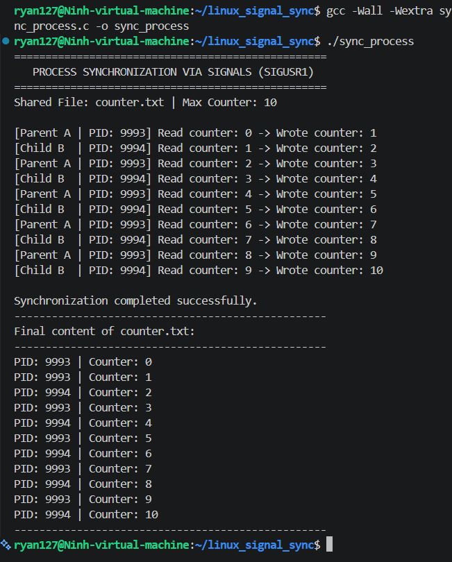
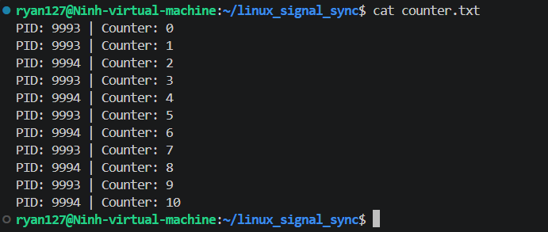

# BÁO CÁO BÀI TẬP: ĐỒNG BỘ TIẾN TRÌNH CHA CON BẰNG SIGNAL TRONG LINUX C

* **Người thực hiện:** Ninh
* **Hệ điều hành:** Ubuntu 22.04 LTS (Linux x86_64, GCC 11.4.0)
* **Mục tiêu:** Xây dựng chương trình đồng bộ hóa hai tiến trình cha (Process A) và con (Process B) cùng chia sẻ một tệp tin dữ liệu, sử dụng tín hiệu người dùng định nghĩa `SIGUSR1` để đảm bảo thứ tự đọc/ghi tăng dần luân phiên, loại bỏ hoàn toàn hiện tượng tranh chấp dữ liệu (Race Condition).

---

## 1. CẤU TRÚC THƯ MỤC DỰ ÁN

```text
linux_signal_sync/
├── sync_process.c      # Mã nguồn chính cài đặt đồng bộ hóa bằng Signal
├── .gitignore          # File cấu hình bỏ qua file thực thi và dữ liệu test
├── README.md           # Báo cáo kỹ thuật chi tiết
└── docs/
    └── images/         # Thư mục lưu trữ ảnh chụp màn hình kết quả
```

---

## 2. PHƯƠNG PHÁP THỰC HIỆN VÀ NGUYÊN LÝ ĐỒNG BỘ BẰNG SIGNAL

### 2.1. Đặt vấn đề và hiện tượng Race Condition
* Khi hai tiến trình độc lập cùng mở một file để đọc dòng cuối cùng và ghi tiếp một dòng mới, nếu không có cơ chế điều phối:
  * Hai tiến trình có thể đọc cùng một giá trị `counter` cũ tại cùng một thời điểm.
  * Cả hai tiến trình cùng tăng lên cùng một giá trị mới và ghi đè dữ liệu của nhau, dẫn đến mất mát dữ liệu và sai lệch thứ tự.

### 2.2. Cơ chế đồng bộ hóa bằng tín hiệu SIGUSR1
* Sử dụng tín hiệu chuẩn POSIX `SIGUSR1` làm thông điệp báo hiệu hoàn thành lượt ghi:
  1. **Khởi tạo:** Tiến trình cha mở file ở chế độ ghi mới (`"w"`), ghi dòng xuất phát `Counter = 0`, sau đó đóng file.
  2. **Tiến trình cha (Parent A):** Đọc dòng cuối cùng, tăng counter lên `1`, ghi tiếp vào file dòng `PID: <pid_A> | Counter: 1`, sau đó gửi tín hiệu `kill(child_pid, SIGUSR1)` để đánh thức tiến trình con và tự đưa mình vào trạng thái chờ.
  3. **Tiến trình con (Child B):** Nhận được `SIGUSR1`, đọc dòng cuối cùng, nhận được counter là `1`, tăng lên `2`, ghi vào file dòng `PID: <pid_B> | Counter: 2`, sau đó gửi tín hiệu `kill(parent_pid, SIGUSR1)` để đánh thức cha và tự đưa mình vào trạng thái chờ.
  4. Quá trình lặp lại luân phiên tuần tự cho đến khi biến counter đạt giới hạn dừng (`MAX_COUNT = 10`).

### 2.3. Chống mất tín hiệu (Lost Wakeup) bằng sigsuspend()
* Trong lập trình hệ thống Linux, việc dùng hàm `pause()` rất dễ dẫn đến lỗi kẹt tiến trình (Deadlock) nếu tín hiệu gửi đến trước khi tiến trình kịp gọi `pause()`.
* **Giải pháp:**
  * Khởi tạo mặt nạ tín hiệu `sigprocmask(SIG_BLOCK, &block_mask, ...)` để chặn `SIGUSR1` ngay từ đầu.
  * Khi tiến trình sẵn sàng chờ lượt tiếp theo, gọi hàm `sigsuspend(&wait_mask)`. Hàm này thực hiện mở chặn và đưa tiến trình vào trạng thái ngủ trong một thao tác nguyên tử (atomic operation), đảm bảo không bao giờ bị lỡ tín hiệu.

---

## 3. HƯỚNG DẪN BIÊN DỊCH VÀ CHẠY CHƯƠNG TRÌNH

### 3.1. Lệnh biên dịch bằng GCC
```bash
gcc -Wall -Wextra sync_process.c -o sync_process
```

### 3.2. Lệnh thực thi chương trình
```bash
./sync_process
```

---

## 4. KẾT QUẢ THỰC NGHIỆM VÀ ĐÁNH GIÁ

### 4.1. Bảng phân tích log thực thi

| Thứ tự | Tiến trình thực hiện | PID | Counter đọc được | Counter ghi mới | Hành động tiếp theo |
| :---: | :--- | :---: | :---: | :---: | :--- |
| **0** | Khởi tạo tệp tin | Parent | - | `0` | Khởi tạo trạng thái gốc, chờ bắt đầu |
| **1** | Parent (Process A) | PID_A | `0` | `1` | Ghi Counter 1, gửi SIGUSR1 tới Child B |
| **2** | Child (Process B) | PID_B | `1` | `2` | Ghi Counter 2, gửi SIGUSR1 tới Parent A |
| **3** | Parent (Process A) | PID_A | `2` | `3` | Ghi Counter 3, gửi SIGUSR1 tới Child B |
| **4** | Child (Process B) | PID_B | `3` | `4` | Ghi Counter 4, gửi SIGUSR1 tới Parent A |
| **5** | Parent (Process A) | PID_A | `4` | `5` | Ghi Counter 5, gửi SIGUSR1 tới Child B |
| **6** | Child (Process B) | PID_B | `5` | `6` | Ghi Counter 6, gửi SIGUSR1 tới Parent A |
| **7** | Parent (Process A) | PID_A | `6` | `7` | Ghi Counter 7, gửi SIGUSR1 tới Child B |
| **8** | Child (Process B) | PID_B | `7` | `8` | Ghi Counter 8, gửi SIGUSR1 tới Parent A |
| **9** | Parent (Process A) | PID_A | `8` | `9` | Ghi Counter 9, gửi SIGUSR1 tới Child B |
| **10** | Child (Process B) | PID_B | `9` | `10` | Đạt ngưỡng MAX_COUNT, gửi SIGUSR1 kết thúc |

### 4.2. Ảnh chụp màn hình kết quả kiểm thử

**1. Kết quả chạy chương trình đồng bộ hai tiến trình:**
<div align="center">



*Hình 1: Hai tiến trình Parent và Child ghi xen kẽ chính xác giá trị counter từ 1 đến 10.*
</div>


**2. Nội dung file counter.txt sau khi hoàn thành:**
<div align="center">



*Hình 2: Kiểm tra nội dung tệp tin counter.txt bằng lệnh cat.*

</div>
